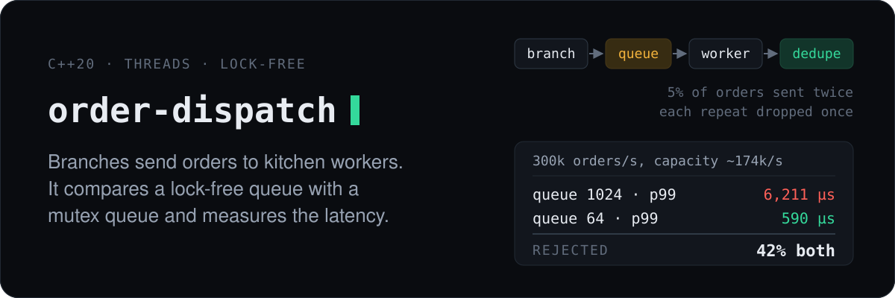
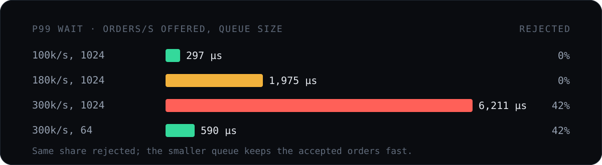
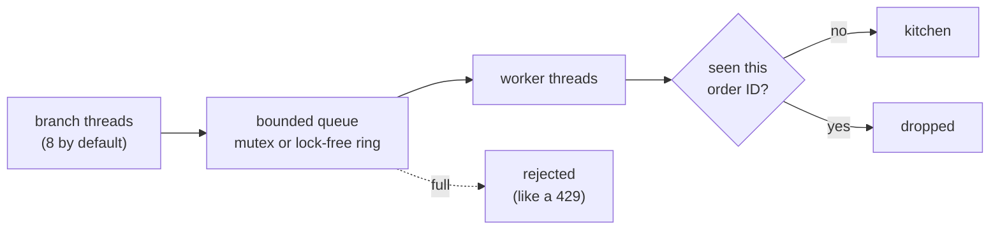
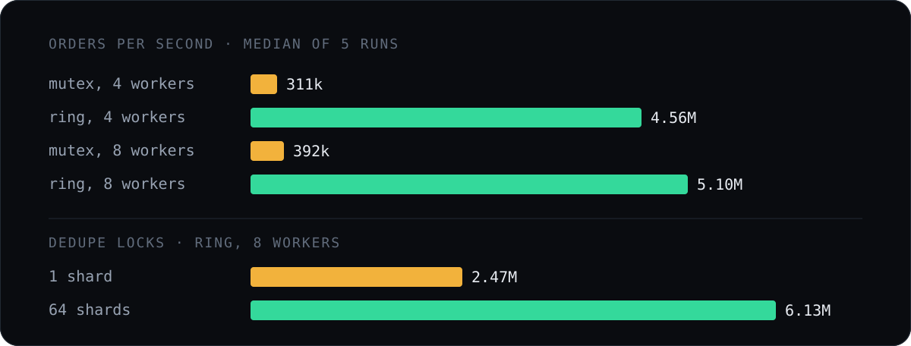

<div align="center">



[](https://github.com/MohammedAltounsi/order-dispatch/actions/workflows/ci.yml)




</div>

Branches send orders to kitchen workers through a bounded queue. About 5% of orders show up
twice, the way a delivery app retries a webhook, and each repeat has to be dropped exactly once.
It's C++20, around 500 lines, no dependencies.

I built it because I'd been giving hand-wavy answers to questions like "is a lock-free queue
worth it?" and "how big should the queue be?" Now I have numbers.



## Quick start

```bash
git clone https://github.com/MohammedAltounsi/order-dispatch && cd order-dispatch
docker build -t order-dispatch .
docker run --rm order-dispatch ./bench.sh
```

Docker is the only requirement. `bench.sh` takes about two minutes and prints every table below.
One real run of the overload case looks like this:

```console
$ docker run --rm order-dispatch ./build/order_dispatch --rate 300000 --work-ns 20000 --capacity 64 --orders 75000
queue=mutex branches=8 workers=4 capacity=64 shards=64 rate=300000 work_ns=20000
orders=600000 processed=374291 duplicates_dropped=13714 shed=242441 shed_pct=38.5
throughput=187108 orders/s
latency_us p50=386.4 p99=510.4 p999=577.9 max=794.9
check=ok
```

## Results

Run in Docker (WSL2) on an i5-14600K, 20 hardware threads, a mix of P-cores and E-cores. Every
number is the median of 5 runs after one warm-up run.



### Mutex queue vs lock-free ring

The ring does about 15x the mutex queue when 8 branches push as fast as they can. With 16
threads on one mutex, most of the time goes into waiting for the lock and waking threads back up.
The ring has no lock and each slot has its own cache line.

The catch is that an idle ring consumer spins. It keeps a core busy even when there's nothing to
do. For quiet or bursty traffic I'd still start with the mutex queue.

### One dedupe lock vs 64

With one shard every worker grabs the same mutex on every order. 64 shards, each on its own
cache line, is 2.5x faster.

I hit a bug here. In libstdc++, `std::hash<uint64_t>` just returns the number. My IDs keep the
branch in the high 32 bits, so `id % 64` put order 1 from every branch on the same shard, then
order 2, and so on. The shard is now picked with the splitmix64 mixer, and a test checks the
spread.

### A rush the kitchen can't keep up with

Here orders arrive on a fixed schedule whether the workers keep up or not, and latency is
measured from when each order was supposed to arrive until a worker finishes it. 4 workers spend
20 µs on each order. On paper that's 200k orders/s; I measured about 174k/s.

At 90% load the median hardly changes, but p99 is about 7x what it was at 50%, and it jumps
around between runs (1.0 to 5.8 ms). There's no slack left, so small bursts pile up.

Once orders come in faster than the workers can handle, both queue sizes reject the same share.
The extra orders have nowhere to go either way. What changes is how long the accepted ones wait.
With 1024 slots, an order sits behind about a thousand others, around 6 ms. With 64 slots, p99
stays under 0.6 ms. That lines up with Little's law: 1024 / 174k per second is about 5.9 ms.

So I think of the queue size as a latency budget. Pick it from how long an order is allowed to
wait, and reject the rest straight away (a 429 with Retry-After) so the client can retry.

The 126 µs median at light load is higher than the 20 µs of work because the generator thread
sometimes wakes up late from `sleep_until`. I count that lateness too, since a real customer
would feel it.

<details>
<summary>All numbers, with the slowest and fastest of the 5 runs</summary>

| Queue, workers | Orders/s |
|---|---|
| mutex, 4 | 310,966 (301,828-315,272) |
| ring, 4 | 4,561,051 (4,447,107-4,638,827) |
| mutex, 8 | 391,573 (368,669-473,687) |
| ring, 8 | 5,104,784 (4,527,589-5,375,883) |

| Dedupe shards (ring, 8 workers) | Orders/s |
|---|---|
| 1 | 2,473,365 (2,437,830-2,504,152) |
| 64 | 6,133,245 (4,471,876-6,350,638) |

| Orders/s offered, queue size | p50 (µs) | p99 (µs) | p99.9 (µs) | Rejected |
|---|---|---|---|---|
| 100k, 1024 | 126 (125-132) | 297 (286-346) | 408 (390-487) | 0% |
| 180k, 1024 | 261 (201-274) | 1,975 (1,015-5,781) | 2,180 (1,246-6,299) | 0% (0-0.2) |
| 300k, 1024 | 5,662 (5,661-5,688) | 6,211 (6,156-6,263) | 6,350 (6,298-6,820) | 42.1% (42.0-42.4) |
| 300k, 64 | 401 (399-403) | 590 (583-592) | 703 (686-777) | 42.2% (41.8-42.4) |

</details>

## My first benchmark was wrong

The first version showed a 7x latency win from shrinking the queue. That number was fake. Each
branch only made its next order after the queue accepted the previous one. When the queue was
full, the waiting happened in orders that hadn't been created yet, so it never got measured.
This is called coordinated omission (Gil Tene explains it in the
[wrk2 README](https://github.com/giltene/wrk2)).

The generator now keeps to a schedule, starts the clock at the scheduled time, and rejects what
doesn't fit.

Every run also checks itself and exits non-zero if something's off. Each order that got into the
queue at least once must be processed exactly once, and every other accepted copy must be counted
as a dropped duplicate.

## Testing

```bash
docker run --rm --security-opt seccomp=unconfined order-dispatch ./ci.sh
```

`ci.sh` builds with `-Wall -Wextra -Wpedantic -Werror` and runs the tests. Then it runs the tests
and the real binary (both queues, both load modes) under ThreadSanitizer, and again under
AddressSanitizer with UBSan. GitHub Actions runs the same script on every push.

TSan needs address randomisation turned off, which is why there's a seccomp flag locally and a
`sysctl` line in the workflow.

The tests cover 8 threads racing for the same 10,000 IDs (each must be won exactly once),
nothing lost through a 4-slot queue for both queue types, FIFO order, a full queue rejecting
pushes, the shard spread and the percentile maths.

## The code

| File | What's in it |
|---|---|
| [`src/mpmc_ring.hpp`](src/mpmc_ring.hpp) | The lock-free queue, based on Dmitry Vyukov's bounded MPMC queue. Every slot has a sequence number that says whose turn it is. A thread claims a position with one compare-and-swap, and release/acquire ordering makes sure the reader sees the item. |
| [`src/bounded_queue.hpp`](src/bounded_queue.hpp) | A mutex and condition-variable queue with the same interface. |
| [`src/dedupe.hpp`](src/dedupe.hpp) | The sharded set of order IDs already seen. |
| [`src/main.cpp`](src/main.cpp) | The load generator, the workers, the stats and the self-check. |
| [`tests/test_main.cpp`](tests/test_main.cpp) | Plain asserts, no framework. |
| [`bench.sh`](bench.sh) | One warm-up and 5 runs per row, prints medians. |

<details>
<summary>Command-line flags</summary>

| Flag | Default | Meaning |
|---|---|---|
| `--queue` | `mutex` | `mutex` or `ring` |
| `--branches` | 8 | producer threads |
| `--workers` | 4 | consumer threads |
| `--orders` | 50000 | orders per branch |
| `--capacity` | 1024 | queue slots (a power of two for `ring`) |
| `--shards` | 64 | dedupe shards, a power of two |
| `--retry-pct` | 5 | share of orders sent twice |
| `--rate` | 0 | orders/s offered in total; 0 means push as fast as possible |
| `--work-ns` | 0 | fake work per order, in nanoseconds |

</details>

## What's missing

The seen-ID set never shrinks. A service that runs for weeks would need to expire old IDs, for
example by keeping two sets and swapping them every retry window.

It's one process, all in memory. Across several machines the queue would be something like Kafka
or SQS, and the dedupe would be a unique key in the database. That's how
[rails-refunds-system](https://github.com/MohammedAltounsi/rails-refunds-system) handles Stripe
webhooks that arrive twice.

Threads aren't pinned to cores, so the P-core/E-core mix adds noise. That's part of why I report
the range and not just one number.

## License

[MIT](LICENSE)
